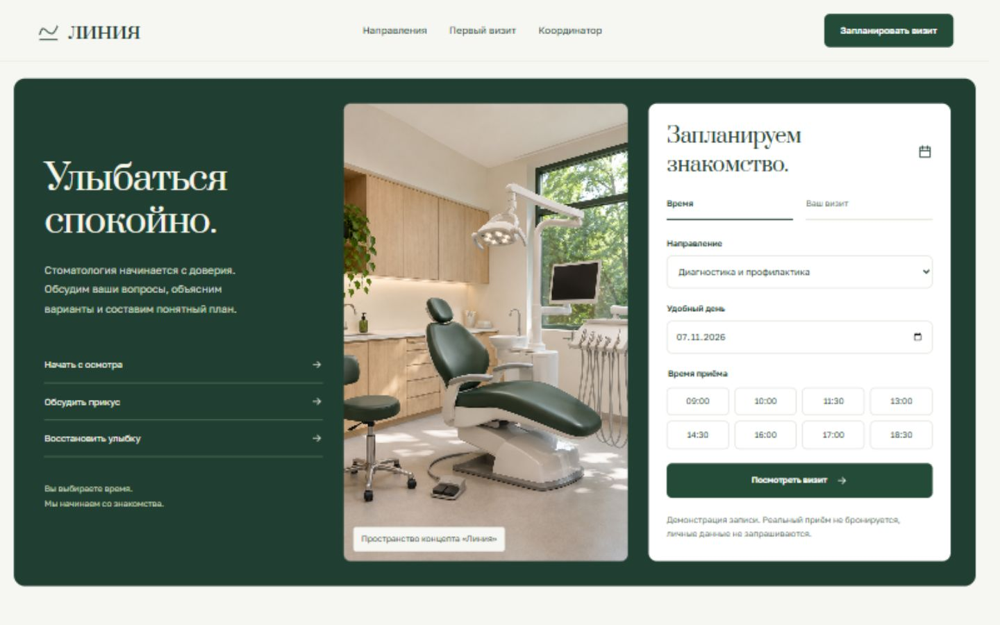

# Линия — стоматология

Интерактивный концепт для портфолио [Fle3n](https://github.com/Fle3n). Интерактивное расписание, выбор услуги и времени, обзор визита, экспорт в календарь и помощник по услугам клиники.



[Мобильная версия](previews/mobile.jpg) · [Связаться в Telegram: @fle3n](https://t.me/fle3n)

## Запуск

Требуется Node.js 20 или новее. Зависимостей для установки нет.

```sh
node server.mjs
```

Откройте [http://localhost:1052](http://localhost:1052). Переменная окружения `PORT` задаёт другой порт, если стандартный занят. `HOST=0.0.0.0` разрешает подключения с других устройств; по умолчанию доступ только с этого компьютера.

`public/` можно развернуть на статическом хостинге. В этой папке находится весь сайт; сервер нужен только для раздачи файлов.

## Возможности и ограничения

Клиника и расписание вымышлены. Реальный приём не бронируется. Помощник не ставит диагнозов и не назначает лечение. Помощник отвечает по локальным правилам; внешняя языковая модель не подключена.

## Проверка

```sh
node --check server.mjs
node --check public/app.js
```

## Ресурсы

Golos Text и Prata распространяются по SIL Open Font License; тексты лицензий находятся в `public/assets/`.

Фотография вымышленной клиники создана с помощью ImageGen.
